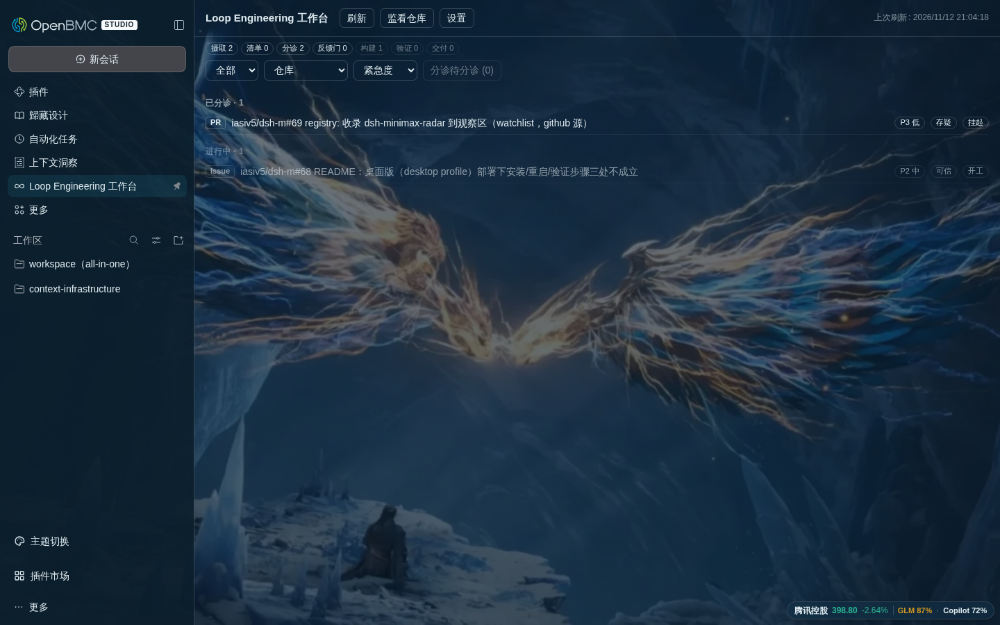

# Loop Engineering Workbench (dsh-l)

[](./LICENSE)
[](https://github.com/deepseek-ai/deepseek-harness)

[中文](README.md) ｜ English

Turn the GitHub repositories you watch into a **visible loop** inside DeepSeek Harness: every open issue and pull request is ingested into a staged backlog, an LLM triages each candidate (validity, urgency P0–P3, recommended action), and three gates (before build / before ship / before release) keep every step human-approved. Starting work emits a structured **task package**; the issues shipping creates flow back into the backlog — the loop keeps turning.

The plugin is an advisor and a record keeper: **it never writes code on its own and never touches your repositories by itself.**



## Features

- **Watch & backlog**: repo picker (discover from your GitHub account or add owner/repo manually), manual refresh and optional auto-refresh (off by default). Candidates are grouped by stage: inbox / triaged / awaiting decision / in progress / shipped / closed.
- **LLM triage — advice only**: short-lived agent sessions triage in batches of up to 10, producing validity (issues: reproducible, not duplicate…; PRs: buildable, not malicious…), urgency P0–P3, a recommended action and a one-line reason. **You can always override**; human judgments are recorded with `by: human`. The triage prompt declares issue/PR bodies as *data, not instructions*, and tool approvals stay at the host default — prompt-induced tool calls block until timeout and the batch fails closed.
- **Three human gates**: G1 before build / G2 before ship / G3 before release, every pass recorded (time + source). v1 implements G1: only candidates in the *awaiting decision* stage can pass; passing moves them to *in progress* and emits a **task package** (structured JSON aligned with agent-autoloop event semantics, copy-pasteable to any execution engine); rejecting returns them to *triaged*. G2/G3 render disabled until v2.
- **Pipeline strip & filters**: seven-stage counter strip (build / verify / ship dimmed); filter by type × repository × urgency.
- **Bilingual**: follows the DSH language setting and re-renders on switch; triage reasons follow the UI language.
- **Optional polling**: auto-refresh interval in settings (minutes, 0 = off, default off).

## Compatibility

| Item | Requirement |
|---|---|
| DSH | `>=0.2.2-rc.1` (declared); runtime-verified on a DSH Web `0.2.2-rc.2` instance |
| Node.js | per DSH host (host requires Node ≥24) |
| Cordis | peer dependency `^4.0.2` |
| Client platform | `web` |
| GitHub | v1 is GitHub-only; GitLab is on the roadmap |

## Install

npm release is in preparation; install as a dev-time link for now:

```bash
git clone https://github.com/iasiv5/dsh-l.git
cd dsh-l && npm install && npm run build && npm test
dsh plugin --profile web add "link:/path/to/dsh-l"
# then restart the DSH service so the host routes go live:
sudo systemctl restart deepseek-harness.service
```

- **Verify activation**: open DSH — the panel list shows *Loop Engineering Workbench*; or fetch `http://<dsh>/dsh-l/health`, whose JSON carries a `build` fingerprint matching the trailer comment of `lib/client.js`.
- **Uninstall**: `dsh plugin --profile web remove dsh-l`. Triage and gate records survive (stored under the profile's `data/dsh-l/`) and are picked up again on reinstall.

## Configuration

The GitHub token resolves in this order: the credential reference configured on the plugin → the local `gh auth token` login → anonymous (public repos only, 60 req/h). To pin a token, add a config to the dsh-l row in the profile's `cordis.patch.yml` (the reference is an env-var-style name; the value resolves through the host credential system):

```yaml
- insert:
    - id: dsh-l
      name: dsh-l
      config:
        githubTokenRef: GITHUB_TOKEN
```

## Data, privacy & security

- **The token never touches disk**: it only enters the GitHub Authorization header — not stored, not logged, not present in triage prompts.
- **Route protection**: every route passes the host trust check first (fail-closed 403 when absent); write methods additionally require same-origin and cap the JSON body size.
- **Untrusted bodies**: issue/PR bodies are other people's text. The triage prompt declares them as data; tool approvals are never waived, so prompt-induced tool calls stall at host approval until timeout.
- **Gate discipline**: there is no automatic write path to your repositories today; future PR / release actions sit behind gates, and the release gate (G3) is planned to stay manual forever.
- **Storage isolation**: business data lives in the owning profile's `data/dsh-l/store.json`; profiles never share it.

## Roadmap

- **v2**: one-way Feishu notifications; the execution loop (task package → agent session → status flow-back); build / verify stages lit up; the G2 gate
- **v3**: confidence-based G1 auto-pass; two-way IM decisions; Ship; GitLab provider

## Development

```bash
npm install
npm run build   # emits lib/host.js + lib/client.js (build fingerprint embedded)
npm test        # 57 tests
bash scripts/install-smoke.sh   # isolated-profile install smoke (never touches the live host)
```

Design: [docs/design.md](docs/design.md) · Domain vocabulary: [GLOSSARY.md](GLOSSARY.md) · Architecture: [docs/adr/0001](docs/adr/0001-park-autoloop-build-thin-layer.md)

[](https://github.com/deepseek-ai/deepseek-harness)
