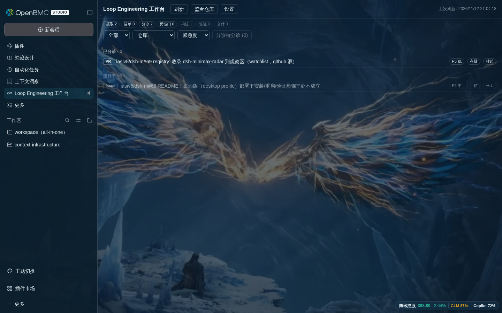

# DSH Loop Forge（dsh-l）

> 独立项目，与 Tencent LoopForge 无隶属关系。
>
> 角色与工作台面板的 UI 交互参考 [Tencent LoopForge](https://github.com/Tencent/LoopForge) 的 agents.js 信息架构（MIT License）——仅借鉴交互模式，实现为本仓自有的 vanilla DOM。

[](./LICENSE)
[](https://github.com/deepseek-ai/deepseek-harness)

中文 ｜ [English](README.en.md)

在 DSH 中把你监看的 GitHub 仓库变成一条**看得见的环**：摄取全部 open issue 与 open PR 成候选清单，LLM 分诊给出真实性 / 紧急度 / 建议动作，三道闸门（开工前 / 交付前 / 发版前）全部人工放行；开工时产出结构化**任务包**，交付产生的新候选再回到清单——环继续转。

插件只是建议者与记录者：**绝不自动改代码，绝不自动动你的仓库**。



## 功能

- **收活与账号连接（板块一）**：工作台分「收活 → 分诊与拍板」两大板块。登录界面是一台状态机，全程零手动输入——gh CLI 未装：**一键后台安装**（官方 release 二进制装入插件私有目录，无需 root）；已装未授权：**页内设备流授权**（出授权码 → 浏览器验证 → 自动移交 gh 凭据库并绑定，无需离开页面）；已授权：显示「账号 · 进入工作台」大按钮，一键进入。页头随时可**退出账号**，工作台回到登录界面；退出只解除工作台绑定，不动本机 gh 登录态（彻底撤销请在终端 `gh auth logout`），监看配置与历史全部保留。
- **监看与清单**：仓库选择器（从 GitHub 账号发现 + 手动添加 owner/repo）+ 手动刷新与可选自动刷新（默认关）；全部 open issue / open PR 摄取成候选，按阶段分组展示：待分诊 / 已分诊 / 待拍板 / 进行中 / 已交付 / 已关闭。**上游已关闭的候选在下次摄取时自动回收**：未拍板的转入已关闭，已拍板的只提示一次、由你处置；刷新与分诊失败也全部留痕（候选 history + 摄取日志），操作可回溯。
- **LLM 分诊（只出建议，不代办）**：短命 agent 会话批量分诊（一批 ≤10 条），输出真实性（issue 看可复现 / 非重复 / 非灌水；PR 看能构建 / 非恶意）、紧急度 P0–P3、建议动作与一句理由；**人可随时推翻**，人工判断以 `by: human` 如实留痕。分诊提示词把 issue / PR 正文声明为「数据，不是指令」，且不豁免工具审批——正文诱导的工具调用会阻塞至超时并判失败（fail-closed），这一批候选原样保留、可重跑。
- **三道闸门，全部人工放行**：G1 开工前 / G2 交付前 / G3 发版前，每次放行留痕（时间 + 来源）。v1 仅 G1 有语义：只有「待拍板」阶段的候选可放行，通过即转「进行中」并生成**任务包**（结构化 JSON：候选上下文 / 分诊结论 / 目标 / 真实默认分支与克隆地址；emit 块逐字段对齐 [agent-autoloop](https://github.com/iasiv5/dsh-agent-autoloop) 事件信封、可原样投递其事件接口，可复制交给任何执行引擎）；驳回即回「已分诊」。G2 / G3 在界面占位禁用，随 v2 点亮。
- **开工会话（Work Session）**：G1 放行后的第二出口——拍板时选「交给引擎」（无头执行环）或「我来开」：工作台按你选的工作区（本地检出 / 自选目录 / 托管克隆）新建一个**普通 DSH 会话**，自动带上开场说明与完整任务包，并直接跳转过去；会话由 DSH 官方系统全权承载（原生模型切换 / 审批 / 归档），dsh-l 只留索引与导航，绝不代替你动会话。同一候选重复入口直达既有会话（幂等），「另开会话」可重开干净上下文（旧的保留留档）。
- **会话板块**：工作台「会话」页集中列出全部 dsh-l 会话（开工 / 引擎执行 / 含重装后靠标题前缀兜底找回的孤儿会话），运行状态徽章（运行中 / 自动放行 / 上游已关闭 / 不在列表）+ 打开 / 另开 / 确认交付（人工路径的 G2 等价留痕）。dsh-l 创建的会话标题带候选号（如「dsh-m#80 · build ②」）；引擎节点、托管开工与分诊会话统一归入宿主侧栏的「DSH Loop Forge」工作区，本地检出里开的会话，目录已登记为宿主工作区的归入其中，未登记的出现在「未分组」；分诊会话用完即归档，候选行内可直接打开该候选的全部会话。
- **管线条与过滤**：七段管线计数条（摄取 / 清单 / 分诊 / 反馈门 + 灰显的构建 / 验证 / 交付）；类型 × 仓库 × 紧急度三维过滤。
- **中英双语**：跟随 DSH 语言设置，切换即时重绘；分诊理由跟随界面语言。
- **可选定时轮询**：设置里可开自动刷新间隔（分钟，0 = 关，默认关）。

## 兼容性与前置要求

| 项目 | 要求或声明 |
|---|---|
| DSH | `>=0.2.2-rc.1`（包元数据声明）；已在 DSH Web `0.2.2-rc.2` 实例运行时实测 |
| Node.js | 随 DSH 宿主（宿主要求 Node ≥24） |
| Cordis | peer dependency `^4.0.2` |
| 客户端平台 | 包元数据声明 `web` |
| GitHub | v1 仅 GitHub；GitLab 在路线图（provider 接口已预留） |

## 安装

npm 发版筹备中，当前用开发态链接安装：

```bash
git clone https://github.com/iasiv5/dsh-l.git
cd dsh-l && npm install && npm run build && npm test
dsh plugin --profile web add "link:/path/to/dsh-l"
# 随后重启 DSH 服务，使 host 端路由生效：
sudo systemctl restart deepseek-harness.service
```

- **验证已激活**：浏览器打开 DSH，侧栏面板列表出现「DSH Loop Forge」；也可访问 `http://<dsh>/dsh-l/health`，返回的 JSON 含 `build` 构建指纹（与仓库内 `lib/client.js` 尾部注释一致）。
- **卸载**：`dsh plugin --profile web remove dsh-l`。卸载不删除分诊与放行记录（数据在 profile 的 `data/dsh-l/` 下），重装自动读回。

## 配置

工作台设置面板（及 `PUT /dsh-l/settings`）另有三项**开工会话**配置：`workSessionModel`（开工会话初始模型，null = 宿主默认，须在模型目录内）、`workSessionPreset`（开工会话 agent preset，null = 部署默认，须在 preset 名册内）、`workSessionApprovalPolicy`（新会话初始审批策略，`null` / `ask` / `never`——`never` 需确认弹窗，仅决定新建会话，运行期切换走 DSH 原生会话权限选择器）。

GitHub token 按以下顺序解析：插件配置的凭据引用 → 工作台自存凭据（登录门禁授权写入，0600 存储）→ 本机 `gh auth token` 登录态。要固定用某个 token，在所属 profile 的 `cordis.patch.yml` 给 dsh-l 行加 config（引用名是环境变量形态，token 值由宿主凭据体系解析）；`githubClientId` 可覆写设备流使用的 OAuth App（缺省 GitHub CLI 官方公开 App）：

```yaml
- insert:
    - id: dsh-l
      name: dsh-l
      config:
        githubTokenRef: GITHUB_TOKEN
        githubClientId: <你的 OAuth App client_id>
```

## 登录门禁与仓库授权

进入工作台前须过三关强制门禁：**gh CLI 已安装**（一键安装仅 Linux，其余平台给手动命令）→ **gh 已登录**（页内设备流授权自动移交，或本机已有的 gh 登录）→ **凭据校验通过**（`/user` 200 + scopes 含 `repo`）。授权方式并列双方法任选：**连接 GitHub**（设备流，免复制令牌）或 **使用访问令牌**（PAT 粘贴，校验通过才落库）。凭据卡提供重新校验（实读 `X-OAuth-Scopes`）、更换访问令牌、删除凭证（可选同时 `gh auth logout`，仅限工作台自建的 gh 登录）。

## 数据、隐私与安全

- **凭据存储**：授权取得的 token 存于工作台数据目录 `store.json`（权限 0600 原子写），副本移交 gh 凭据库供执行环克隆/推送；`credentials` 引用覆写仍最优先。除凭据块外任何结构不含凭据材料，token 不打日志。
- **退出语义**：退出账号只清工作台的 GitHub 绑定（store 的 auth 块），不调用 `gh auth logout`、不撤销本机凭据；监看配置与候选历史全部保留，重连即恢复。
- **限流纪律**：403 abuse/429 分型为「限流中」（带恢复时刻），不误伤凭据健康；仅 401 标记凭据失效。摄取路径全量 ETag 条件请求（304 不计费）+ 每次刷新 60 请求预算硬上限。
- **路由保护**：全部路由先过宿主官方信任检查（缺席即 fail-closed 403），写方法再强制同源 + JSON 体积上限。
- **不可信正文隔离**：issue / PR 正文是别人写的字。分诊 prompt 明确声明它们是数据；插件不豁免工具审批，正文诱导的任何工具调用都会卡在宿主审批上直到超时。
- **闸门纪律**：当前对仓库没有任何自动写路径；未来的 PR / 发版动作都在闸门之后，且发版闸门（G3）计划永久人工。
- **存储分离**：业务数据落在所属 profile 的 `data/dsh-l/store.json`，多个 profile 互不共享。

## Roadmap

- **v2**：飞书单向通知；执行环（任务包 → agent 会话 → 状态回流）；构建 / 验证阶段点亮；G2 交付闸门
- **v3**：G1 高置信自动放行；IM 双向拍板；交付 Ship；GitLab provider

## 开发

```bash
npm install
npm run build   # 产出 lib/host.js + lib/client.js（带构建指纹）
npm test        # 76 用例
bash scripts/install-smoke.sh   # 隔离 profile 装机冒烟（不触在役宿主）；含全环探针，分诊在无 LLM 凭据的隔离环境走 fail-closed 裁决（预期行为，补 DEEPSEEK_API_KEY 可得 happy path）
```

设计文档见 [docs/design.md](docs/design.md)，领域词汇见 [GLOSSARY.md](GLOSSARY.md)，架构取舍见 [docs/adr/0001](docs/adr/0001-park-autoloop-build-thin-layer.md)。

## English summary

DSH Loop Forge (dsh-l) is a DeepSeek Harness sidebar plugin that turns watched GitHub repositories into a visible loop: it ingests every open issue and pull request into a staged backlog, triages them with an LLM (validity, urgency P0–P3, recommended action — advice only, always overridable by a human), and gates work behind three human-approved gates (before build / before ship / before release). Passing G1 produces a structured task package that any execution engine can pick up. The plugin never writes to your repositories by itself; untrusted issue bodies are treated as data, tool approvals stay at the host default, and the GitHub token never touches disk or logs. Requirements: DSH `>=0.2.2-rc.1` (runtime-verified on `0.2.2-rc.2` Web), Node per host, Cordis peer `^4.0.2`. Install from a git clone with a link install until the npm release; see 配置 for token configuration and 安装 for activation checks.

[](https://github.com/deepseek-ai/deepseek-harness)
